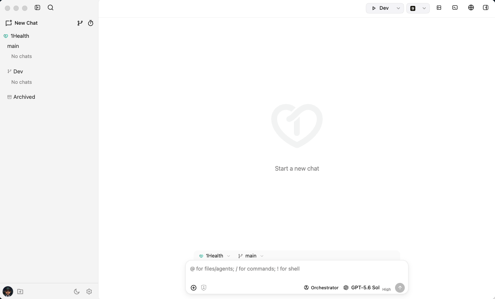

# DevRyan

## **OpenCode, everywhere.** Desktop. Browser. Phone.

### A rich interface for [OpenCode](https://opencode.ai). Review diffs, manage agents, run dev servers, and keep the big picture while your AI codes.



## Installation

Download the macOS Apple silicon DMG (`DevRyan-<version>-arm64.dmg`) from [DevRyan releases](https://github.com/1H-Team/DevRyan/releases). Use Update in the app to download, verify and install a new version. macOS builds are ad-hoc signed. Windows x64/ARM64 installers, when published, are unsigned prereleases; see [docs/RELEASE_PIPELINE.md](docs/RELEASE_PIPELINE.md) for release assets and qualification gates.

Open **Settings → Providers → OpenAI → Codex browser (legacy)** on the local administrator interface. One OpenCode sign-in supplies chat and ChatGPT plan usage; there is no separate usage sign-in. Existing token-sharing connections keep working for chat; sign in with Codex to enable usage. Images currently require an explicitly selected OpenAI API key. No billing fallback is automatic.

## Development

Use Node.js 22.13 or newer and the Bun version pinned in `package.json`. Install dependencies with `bun install --frozen-lockfile`, then run the full local stack with:

```bash
bun run dev
```

The dev orchestrator keeps the API, web build watcher, and UI typecheck watcher running. If a child process exits unexpectedly, it is restarted automatically. Press **Ctrl+C** in the terminal to stop everything.

Every dev launcher (`dev`, `dev:web:hmr`, `dev:web:full`, the web server watcher and Electron dev) runs on a private data directory and a private `XDG_STATE_HOME` under `<os tmpdir>/devryan-development/<checkout>/<mode>`, so it provisions its own native runtime bundle and never takes the installed app's OpenCode runtime. Set `DEVRYAN_DATA_DIR` or `DEVRYAN_RUNTIME_BUNDLE_ROOT` to choose your own.

Use **Services → Stop DevRyan** in the app when you want to end the dev stack from the UI (with confirmation).
